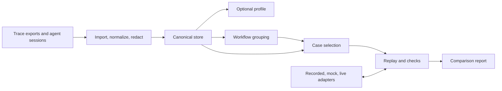
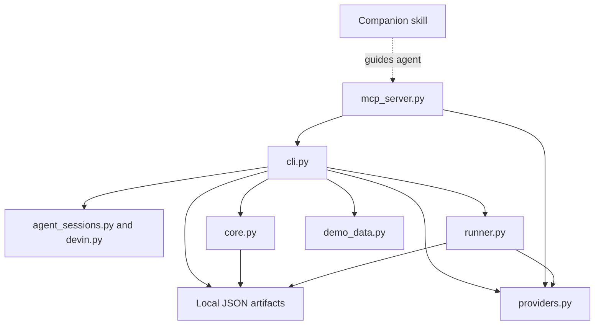

# SwitchIt! module map

Mapped from the repository on 9 November 2026, commit `bc8b369`. This describes existing source organization; proposed modules are marked separately. Python package: 0.1.5. JavaScript package: 0.1.1.

## Product-level flow



The default Python `run` command executes import → map → cases → replay → report. `profile` is a separate command reading the imported store. Editing a workflow map or case file is an intentional review point between stages.

## Python implementation: primary harness

The following are logical modules. Several live together in the same large source file today.

| Logical module | Responsibility | Implementation | Main output |
| --- | --- | --- | --- |
| Entry points and orchestration | Parse commands, choose paths and adapters, run stages | [cli.py](../switchit/cli.py), [__main__.py](../switchit/__main__.py), [pyproject.toml](../pyproject.toml) | Stage execution and console output |
| File importers | Parse JSON/JSONL, OTLP, Langfuse-style exports, Parquet | [core.py](../switchit/core.py): `import_jsonl`, `import_otlp`, `import_langfuse`, `import_parquet` | Imported call records |
| Agent-session importers | Discover and read supported local agent formats; collect session metadata | [agent_sessions.py](../switchit/agent_sessions.py) | Raw calls and provenance |
| Devin importer | Fetch authorized cloud session metadata and convert it to task records | [devin.py](../switchit/devin.py) | Task-level metadata, not full model-call recordings |
| Normalization and storage | Redact, normalize messages/tools/results, distinguish usage provenance, build calls/traces/sessions | [core.py](../switchit/core.py): `make_call`, `build_store`, `save_store` | `store.json` |
| Profile analysis | Extract prompts, tool inventory, inferred argument schemas, provider mix, usage and errors | [core.py](../switchit/core.py): `build_profile`, `infer_tool_schema` | `profile.json`, `app_config.inferred.json` |
| Workflow discovery | Group traces using text similarity and tool overlap; preserve reviewed edits when requested | [core.py](../switchit/core.py): `group_workflows`, `apply_edits` | `workflows.json` |
| Case selection | Select common, costly, risky, failed cases; attach reference behavior, default checks and tool fixtures | [core.py](../switchit/core.py): `select_cases`, `default_checks` | `cases.json` |
| Provider adapters | Convert requests/responses and provide recorded, mock, OpenAI-compatible, Anthropic and Bedrock interfaces | [providers.py](../switchit/providers.py) | Normalized replay results and capability declarations |
| Replay engine | Run selected cases, optionally continue with recorded fixtures, checkpoint and resume | [runner.py](../switchit/runner.py): `run_replay`, `replay_case`, `_chain_target_turns` | `results.json`, `run_state.json` |
| Evaluation | Evaluate declared checks, compare tools, classify pass/fail/error/uncertain | [runner.py](../switchit/runner.py): `evaluate_check`, `compare_tools`, `finalize_case` | Per-case verdicts and findings |
| Reporting | Aggregate findings, usage and capability gaps; prioritize fixes; render a local report | [runner.py](../switchit/runner.py): `aggregate`, `build_report`, `render_html` | `report.json`, `report.html` |
| MCP interface | Expose pipeline and inspection operations through stdio JSON-RPC | [mcp_server.py](../switchit/mcp_server.py) | Agent-callable tools |
| Synthetic demonstration | Provide bundled records without reading personal traces | [demo_data.py](../switchit/demo_data.py), [examples](../examples) | Demonstration inputs |

Local importer functions cover Claude Code, Codex, Cursor, OpenCode, Cline, Aider, Gemini CLI, Copilot CLI, Muse, and Grok Build. Discovery and source completeness vary by format. Catalog-only cloud/Dot records are title-level stubs: discovery evidence, not replayable transcripts.

Capability presence is not a correctness certification. The preceding review documented replay and adapter defects; see the [prospectus](switchit-prospectus-2026-11-09.md).

## Actual dependency structure



The CLI is the orchestrator. The MCP server invokes command handlers for pipeline work and contains its own status/report-reading operations. The skill supplies agent instructions; it does not execute the harness by itself.

Python exposes ten MCP tool names: `switchit_import`, `switchit_profile`, `switchit_map`, `switchit_cases`, `switchit_replay`, `switchit_report`, `switchit_run`, `switchit_status`, `switchit_read_report`, and `switchit_list_providers`. This is an inventory of declared tools, not a fresh functional test of every route.

## Data artifacts and boundaries

```text
.switchit/                     default configurable state directory
├── store.json                 normalized calls, traces, sessions, provenance
├── profile.json               optional analysis of imported usage
├── app_config.inferred.json   optional editable inferred configuration
├── workflows.json            inferred/reviewed task groupings
├── cases.json                selected inputs, historical evidence and checks
└── run/                      overridable with a run-directory option
    ├── run_state.json        checkpoint and run fingerprint
    ├── results.json          per-case replay results
    ├── report.json           structured comparison report
    └── report.html           self-contained human-readable report
```

`store.json` organizes source material into calls → traces → sessions. Workflow grouping operates on traces. Case selection uses both the store and workflow map. Replay consumes cases; reporting consumes cases and completed results, plus adapter capability information.

This is local file persistence, not a hosted database or multi-tenant service. SQLite access in agent importers reads upstream agent stores; it does not make SQLite the SwitchIt application database.

Live model replay requires explicit remote opt-in. Devin import is a separate explicitly requested network path. Recorded tool fixtures can be supplied during replay, but the harness does not execute actual Supermemory, messaging, payment, or other business tools. A live target model can still incur inference charges when tool results are recorded fixtures.

## TypeScript implementation: separate port

The Node package is an independent implementation, not a wrapper around Python.

| File under `harness-js/src/` | Role | Python equivalent |
| --- | --- | --- |
| [core.ts](../harness-js/src/core.ts) | Types, normalization, redaction, canonical store | Parts of `core.py` |
| [importers.ts](../harness-js/src/importers.ts) | JSON/JSONL, Claude Code and plain Codex imports | Parts of `core.py` and `agent_sessions.py` |
| [analysis.ts](../harness-js/src/analysis.ts) | Profiling, workflow grouping, case selection | Analysis sections of `core.py` |
| [providers.ts](../harness-js/src/providers.ts) | Recorded/mock/OpenAI-compatible/Anthropic adapters | Subset of `providers.py` |
| [runner.ts](../harness-js/src/runner.ts) | Replay, checks and checkpointing | Replay/evaluation sections of `runner.py` |
| [report.ts](../harness-js/src/report.ts) | Aggregation and report rendering | Reporting sections of `runner.py` |
| [cli.ts](../harness-js/src/cli.ts) | Node command orchestration | `cli.py` |
| [mcp.ts](../harness-js/src/mcp.ts) | Six MCP tools; launches the Node CLI as a child process | Subset of `mcp_server.py` |

The [Node README](../harness-js/README.md) documents missing parity, including Bedrock, several import formats, Devin, and preservation of reviewed workflow edits. Both packages expose `switchit` and `switchit-mcp`, so documentation should identify which installation it describes.

## Agent skill and packaging

| Location | Responsibility |
| --- | --- |
| [skills/switchit/SKILL.md](../skills/switchit/SKILL.md) | Guides workflow review, defining checks, replay and interpreting uncertainty |
| [scripts/install-skill.sh](../scripts/install-skill.sh) | Shell installation path for the skill |
| [npm/bin/install.js](../npm/bin/install.js) | `switchit-skill` installer; copies the bundled skill to `~/.agents/skills/switchit` |
| [npm/skills/switchit/SKILL.md](../npm/skills/switchit/SKILL.md) | Installer package's skill copy |
| [harness-js/skills/switchit/SKILL.md](../harness-js/skills/switchit/SKILL.md) | Node harness's skill copy |
| [pyproject.toml](../pyproject.toml), [harness-js/package.json](../harness-js/package.json) | Harness package metadata and executable entry points |

The skill installer and the JavaScript harness are distinct npm packages with different jobs. Multiple skill copies require release-time synchronization.

## Website modules

`marketing-next/` is a static Next.js marketing application. It is not the backend or a hosted replay dashboard.

| File/component | Responsibility |
| --- | --- |
| [app/layout.tsx](../marketing-next/app/layout.tsx) | Shared page frame, fonts, metadata, header/footer |
| [app/page.tsx](../marketing-next/app/page.tsx) | Compose the landing-page sections |
| [components/hero.tsx](../marketing-next/components/hero.tsx) | Main product introduction |
| [components/product-story.tsx](../marketing-next/components/product-story.tsx) | Sources, workflow explanation, outcomes and target-provider sections |
| [components/migration-demo.tsx](../marketing-next/components/migration-demo.tsx) | Synthetic interactive comparison and installation panel |
| [components/client.tsx](../marketing-next/components/client.tsx) | Install card, clipboard buttons and reveal behavior |
| [components/site-chrome.tsx](../marketing-next/components/site-chrome.tsx) | Brand, navigation and footer |
| [app/guide/page.tsx](../marketing-next/app/guide/page.tsx) | Getting-started documentation |
| [next.config.ts](../marketing-next/next.config.ts) | Static export configuration |
| [scripts/verify-ui.cjs](../marketing-next/scripts/verify-ui.cjs) | Browser-based UI verification |

The synthetic demo does not call providers or the harness. `marketing/index.html` and `docs/index.html` are additional static website files outside the Next.js app. Research Markdown and SVG architecture diagrams also live in `docs/`.

## Verification modules

Python tests are organized around core import/analysis, provider conversion, runner behavior, CLI, MCP, catalog stubs, and Muse/Grok importers. See [tests](../tests). Sample JSON/JSONL/OTLP/config inputs live in [examples](../examples).

The prior review found the JavaScript test command ran zero tests. This mapping task did not rerun the suites or change executable code. Documentation paths and formatting were checked.

## Proposed extensions and their attachment points

| Proposed module — not implemented | Attaches to | Purpose |
| --- | --- | --- |
| Hermes/OpenClaw capture adapters | Import boundary and canonical store | Capture host-specific actions, IDs, skills, configuration and outcomes |
| Native Hermes plugin | MCP/CLI plus host hooks | Make selected capture and assessment available inside Hermes |
| Workflow contract format | Cases and evaluation | Represent required outcomes, ordering, approvals and allowed variation |
| Isolated environment runner | Replay engine | Prepare/reset memory and tool state; validate effects in staging |
| Versioned workflow registry | Artifact persistence | Store reusable contracts, fixtures and test history |
| CI/team reporting | Reports and run metadata | Apply reviewed thresholds and share change evidence |

Supermemory belongs at the business-tool/context boundary in this design. It should not be added as a chat-model provider. Dedicated live memory evaluation would require new adapters and controlled state.

## Suggested code boundaries for future maintenance

`core.py` currently combines importing, normalization, storage, profiling, grouping and case selection. `runner.py` combines execution, evaluation, aggregation and HTML generation. Those are the main candidates for eventual separation into focused modules. The TypeScript port already separates `analysis.ts` and `report.ts`, but duplicated behavior still needs a shared compatibility contract.

Recommended order: repair replay correctness; define shared case/result contracts; then extract modules when implementation work benefits from it. This map does not propose an immediate repository-wide refactor.
