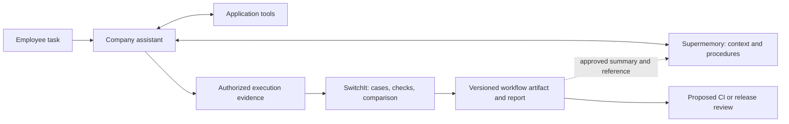

# SwitchIt! — Product prospectus

Research date: 9 November 2026. Repository reviewed: `bc8b369`, Python harness 0.1.5 and JavaScript harness 0.1.1. This is a product strategy proposal, not evidence of an existing partnership or validated revenue. Current implementation, proposed capabilities, and external claims are distinguished below.

**Proposed promise: Turn real agent work into reusable, testable workflows—and show what survives when the underlying stack changes.**

The immediate offer is a workflow migration audit. The larger opportunity is a library of versioned workflow specifications and evidence that a company can reuse across agents. Supermemory and other memory systems can provide the knowledge and retrieval layer; SwitchIt can provide the tests of how that knowledge becomes action.

**1. What “exact workflows” should mean**

A valuable workflow record includes the task, initial state, context retrieved, model and tool configuration, actual actions, results, approvals, and outcome. A conversation summary alone cannot establish whether an invoice was sent, a namespace was respected, or a customer record was updated correctly.

Exact evidence is useful. Requiring every future run to reproduce the same transcript is often counterproductive. Two agents can search in a different order and still finish correctly. A refund workflow, however, must preserve the customer ID, permitted amount, approval requirement, and final state.

SwitchIt should distinguish three things:

| Item | Purpose | Example |
| --- | --- | --- |
| Recorded execution | Preserve what actually happened, including missing evidence | Agent searched policy version 7, proposed a refund, then received an approval |
| Workflow specification | Define required outcomes, dependencies, and allowed variation | Approval must precede refund; amount and recipient must match |
| Verification result | Describe what was tested under a particular configuration | Candidate model satisfied these checks on these cases, with these unresolved gaps |

Memory systems may also store procedures and past experiences. The distinction is therefore not exclusive ownership of “how-to” knowledge. SwitchIt's proposed responsibility is making a procedure executable as a test, retaining its evidence, and rechecking it after change.

The current repository reconstructs workflows from traces and selects representative cases. It does **not** yet preserve every execution exactly: repeated calls and fixtures are collapsed by tool name, and selected cases are built around a representative model call. Full workflow fidelity is a development requirement, not a present claim.

**2. What the public research actually supports**

This was a targeted review of Reddit discussions, public X posts, Product Hunt listings, and primary documentation. It is qualitative discovery, not a representative customer survey. Several discussions are led by makers promoting their own products. Their presence establishes activity and competing approaches; it does not establish willingness to pay.

| Source | Observed activity | Implication for SwitchIt |
| --- | --- | --- |
| [Reddit: testing model switches](https://www.reddit.com/r/AI_Agents/comments/1wvah6h/how_are_you_testing_model_switches_for_ai_agents/) | An agent builder raises silent changes in tool selection and arguments. Replies describe homegrown replay harnesses and fixture-matching problems. The author discloses building EvalShift. | Migration is a concrete trigger. Tool behavior needs explicit checks, and this is already a competitive category. |
| [Reddit: testing agent workflows](https://www.reddit.com/r/AI_Agents/comments/1up9s9k/how_are_you_regressiontesting_agent_workflows/) | A Runme builder asks about skills, MCP configuration, memory, and workflow regressions. Respondents discuss invariant checks, observable effects, and the maintenance burden of recorded fixtures. | Whole-workflow contracts are useful. Reduce fixture maintenance and false alarms instead of treating every path difference as failure. |
| [X: Dan Kornas on Tracely, 1 October 2026](https://x.com/DanKornas/status/2105511507119259989) | Describes converting production failures into replayable regression cases and CI checks. | Turning traces into tests is already being built and promoted; it cannot be SwitchIt's sole differentiation. |
| [Product Hunt: BotGauge](https://www.producthunt.com/products/botgauge-2) | Launch material advertises agent red-teaming, traces, replay, and persistent regression tests; discussion includes tool interactions and approval failures. | Reliability is an active product category. Avoid claiming that existing products only grade text. |
| [Product Hunt: Supermemory](https://www.producthunt.com/products/supermemory) | Lists the original information-organizing product and Universal Memory MCP launch. | MCP is a relevant distribution surface, but older launch copy does not describe the entire current product. |

The Reddit pages were read through web retrieval after Firecrawl reported that direct scraping was unsupported. The X post was retrieved with its text and thread. Product Hunt claims were read as launch claims, not independently tested capabilities. No private posts, interviews, or paid-customer data were used.

**3. What SwitchIt can offer now**

The repository already contains a useful foundation: importers, a normalized trace store, inferred workflow grouping, representative case selection, recorded baselines, provider adapters, checks, reports, CLI, MCP tools, and an agent skill.

| Offer | Status and honest scope |
| --- | --- |
| Workflow inventory | Available: inspect imported tasks, tools, usage, and failures. Groupings are inferred and need review. |
| Migration assessment | Available as an early harness: select cases, compare a candidate, and inspect differences. Adapter and replay defects prevent a blanket readiness guarantee. |
| Regression starter suite | Available: editable cases and deterministic checks. Default checks are starting points, not business acceptance criteria. |
| Supermemory-dependent workflow analysis | Available where traces contain those calls. Calls and recorded results can be inspected without accessing a live memory account. |
| Agent-accessible assessment | Available through CLI, MCP, and skill. A host can invoke SwitchIt tools with its existing integration work. |
| Native Supermemory plugin | Proposed; no dedicated installed integration was found. |
| End-to-end state verification, automatic migration, hosted workflow registry | Proposed; not current product capabilities. |

The repo explicitly treats Supermemory as a business tool and never executes live business tools in replay. A live target model still requires provider access and can incur inference costs; recorded tool fixtures do not make that model call offline. See the [current integration boundary](../README.md#if-your-workflow-already-uses-business-tools-supermemory-internal-apis-).

The preceding review reproduced mismatched OpenAI chain IDs, missed repeated tool calls, and understated multi-turn usage and latency. It also found a Bedrock message-format issue and a JavaScript test command running zero tests. These are release prerequisites for a trustworthy paid assessment. Python's 161-test run completed without failures, with two skipped; passing synthetic tests does not establish live-provider correctness.

**4. Fit with Supermemory and company assistants**

Yes: SwitchIt could help applications built on Supermemory, and potentially Supermemory's own integration and engineering teams. The most accessible initial users are developers who already own an agent application and its traces. A vendor partnership is a later possibility, not a dependency.

There is a material product-status update: Supermemory announced that its hosted Company Brain and Nova were discontinued on 9 September 2026, while its MCP and plugins continue. It subsequently published the Company Brain harness as open source. An integration proposal should target the current memory API, supported agent surfaces, or an independently deployed company assistant. [Service update](https://supermemory.ai/blog/an-update-to-supermemory/), [open-source announcement](https://supermemory.ai/blog/open-sourcing-company-brain/).

Three useful offers follow:

- **Model-change assurance:** keep recorded memory results fixed and test how a new model searches, interprets, and acts. This isolates model behavior; it cannot establish the quality of a changed live retrieval system.
- **Memory-change assurance:** hold the model and task set fixed, run against separately prepared memory configurations, and measure task outcomes. This requires new memory adapters and isolated test state. It is relevant to retrieval settings, SDK upgrades, and provider changes.
- **Reusable company procedures:** retrieve a reviewed workflow through the company's knowledge layer, execute it through the host agent, and attach SwitchIt's checks and versioned test history. This is the longer-term product direction.

Supermemory already provides MemoryBench for comparing memory providers through an ingest/search/answer/evaluate pipeline. SwitchIt should complement it with application-specific actions, approvals, state transitions, and business outcomes. Claiming simply to benchmark memory would duplicate existing work. [MemoryBench documentation](https://supermemory.ai/docs/memorybench/overview).

**5. A concrete integration design**

The first integration should be an evaluation companion to an existing agent. A dedicated plugin marketplace or native Supermemory extension mechanism is not assumed.

Implementation surfaces:

1. **MCP companion:** expose the existing assessment tools to the host agent. Add host-specific setup and a clear workflow for supplying authorized traces. MCP supplies callable tools; it does not automatically capture every execution or enforce a release gate.
2. **SDK instrumentation:** wrap the host's model and tool boundaries to retain correlation IDs, arguments, results, state references, approvals, and versions. Record Supermemory calls without turning it into a model-provider adapter.
3. **Workflow registry integration:** retain the canonical artifact in versioned storage. Optionally index its approved description and reference in memory for discovery. Semantic retrieval should not be the only storage for exact fixtures and test history.

Use Supermemory's current SDK and namespace model. Its docs show namespaced add/search/profile calls and changed search defaults relative to legacy SDKs—exactly the kind of configuration change that should be pinned during comparison. Namespace resolution must come from the authenticated application, with access enforced by that application. [SDK documentation](https://supermemory.ai/docs/integrations/supermemory-sdk), [product documentation](https://supermemory.ai/product/).

For testing, snapshot the relevant inputs or prepare an isolated test namespace; do not assume the service supplies a transactional snapshot API. Memory writes need repeatable setup and cleanup in that test environment. Human approval and external actions should be simulated first, with later staging validation for actual effects.

**6. First demonstration: a memory-backed support workflow**

Illustrative task: “Prepare a refund response for customer A under our current policy.”

The agent retrieves customer context, retrieves the policy, checks the order, proposes an amount, requests approval when required, and prepares a response. A staging test may then execute the approved refund.

The workflow checks should establish that:

- Customer and workspace scope are correct.
- The applicable policy version is used.
- Amount, currency, and order identifiers match the evidence.
- Required approval happens before a side effect.
- Retries do not create duplicate refunds.
- The response agrees with the observed result.
- Full-run usage and latency are measured consistently.

Required sequencing belongs in these rules. Harmless differences in wording or independent read order should remain permissible. These business checks are proposed extensions, not all built-in checks today.

Compare configurations separately: first change only the model; then change only memory retrieval; finally evaluate the intended combined configuration. Label results as recorded-fixture, isolated live-memory, or staging end-to-end evidence. This prevents a fixture-based pass from being presented as proof of production behavior.

**7. Competition and the credible opening**

| Product | Relevant documented overlap | Consequence |
| --- | --- | --- |
| [EvalShift](https://github.com/evalshift/evalshift-cli) | Model migration, tool-call regressions, and CI gating | Direct competition for the current migration pitch. |
| [Tracely](https://github.com/jwuthri-cloud/Tracely-ai) | Production traces, failure promotion, fixture replay, and CI | Trace-to-test conversion is already offered. |
| [LangSmith](https://docs.langchain.com/langsmith/evaluation-types) | Offline evaluation, reference tool calls, regression comparison | Do not claim established eval tools ignore workflows or tools. |
| [BotGauge](https://www.producthunt.com/products/botgauge-2) | Agent red-teaming, behavior failures, replay, and regression tests | General agent reliability is crowded. |
| [Supermemory MemoryBench](https://supermemory.ai/docs/memorybench/overview) | Comparable memory-provider evaluation | Integrate useful component measurements rather than rebuilding every benchmark. |

The proposed opening is narrower: **a portable workflow artifact for memory-backed business agents, carrying executable requirements and evidence across model, memory, tool, and harness changes.** The current importers and local workflow analysis are useful starting assets. The reviewed evidence does not prove that this opening is unoccupied or defensible.

Defensibility would come from high-fidelity integrations, low-maintenance test artifacts, useful workflow contracts, trusted comparison results, and adoption by teams. A connector count or a new category name is insufficient. Tenant-specific data remains private; reusable patterns should be explicitly contributed or synthetic.

**8. Who would use it and what they would buy**

| Initial segment | Trigger | Proposed deliverable |
| --- | --- | --- |
| Small teams running tool-using agents | New model, cost reduction, prompt or SDK upgrade | Reviewed workflow suite and evidence-backed change report |
| Company-assistant builders using memory | Retrieval or permission changes | Tests covering context scope, decisions, approvals, and outcomes |
| Agencies maintaining several client agents | Repeated release checks | Client-specific workflow packs with repeatable reports |
| Memory and agent infrastructure vendors | Customer adoption or migration friction | Reference integrations and downstream workflow validation |

Begin with a developer-owned application and one consequential workflow. Pure chat or bookmarking products have less need for tool/state contracts; they are weaker initial targets.

A possible business model is an open-source local harness with paid team workflow management, scheduled comparisons, review history, private runners, and CI integration. An initial paid migration assessment could test willingness to pay before building hosted infrastructure. These are hypotheses; this research establishes neither pricing nor market size. Measure saved engineering effort and caught regressions before choosing a subscription model.

**9. Proposed validation sequence**

1. **Repair fidelity.** Preserve ordered repeated calls and stable IDs; match fixtures using arguments and relevant state; stop unsupported branches as unresolved; fix adapters and complete-run accounting. Add targeted tests for the reproduced defects.
2. **Publish one complete example.** Build the support workflow above with a small, reviewed dataset and known injected failures. Include wrong-customer retrieval, missing approval, stale policy, and duplicate-action cases. Report both detected and missed faults.
3. **Test with three design partners.** Obtain consented traces from teams already using a memory-backed agent. Record time to first useful suite, time spent maintaining fixtures, actionable versus noisy findings, and whether they rerun after their next change.
4. **Add the smallest reusable contract.** Version task, initial state, actor, configuration, fixtures, invariants, allowed variation, observed effects, provenance, and validity limits. Keep unknown state explicit.
5. **Build distribution around observed use.** Add a polished MCP setup and CI output first if teams repeatedly use them. Build a hosted registry or vendor plugin only when the workflow justifies it.

Suggested pilot targets—not established performance: a reviewed suite of 20–30 cases per partner, all deliberately injected critical faults detected in that suite, and repeated use on a subsequent change. Track review time and false alarms as well as pass rates. Sampled success, even over repeated runs, remains bounded evidence.

The key commercial test is whether a developer prefers maintaining this suite to their existing pytest/JSON scripts, and whether the report changes a release decision. If it does neither, broader positioning will not solve the product problem.

**Recommended prospectus copy**

> SwitchIt turns real agent executions into reusable workflow tests. It helps teams understand which tasks depend on which models, memory systems, and tools, then evaluate a proposed change against explicit requirements. For company assistants, the goal is to preserve the way work gets done as the AI stack evolves—with evidence of what passed, what broke, and what still needs testing.

Use that as the direction, with the current public product described as an early workflow migration and replay harness. The next proof should be one reliable memory-backed workflow surviving a meaningful change.

Follow-up research: [Hermes and other agent ecosystems](agent-workflow-research-2026-11-09.md), including live browser checks, existing native capabilities, and integration limits. [Short sales ideas](switchit-sales-ideas.md) translates the findings into proposed offers, buyers, and reasons to use them.
